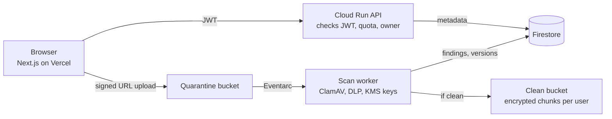

# Glashus — Project Documentation

As of Nov 14, 2026 · Anas Abuelhaag · Live version: https://claude.ai/artifact/Tk1dFY1HxrgZxLbapgu1US

## Overview

Glashus is an exposure-aware personal cloud drive on Google Cloud. Normal drives show you your files; Glashus shows who can see them, and fixes it in one click.

- **Course:** Cloud Computing (SET 472), 15 marks. Also built as a portfolio piece.
- **Owner:** Anas Abuelhaag.
- **Name:** Glashus, from German *Glashaus*, a glass house. Everything inside is visible to you and only to you.
- **One-line pitch:** Drive shows you your files. Glashus shows who can see them.

**Goals**

1. Store, preview and share files safely, with every upload scanned before it lands.
2. Make exposure visible: every link, person and AI read on one screen, with a score.
3. Use AI only with consent, with sensitive values masked and every read logged.
4. Run on managed Google Cloud services with infrastructure as code and near-zero cost at demo scale.

**Non-goals:** competing with Google Drive on price per GB, real-time co-editing, and native mobile apps.

## Problem

Cloud drives make sharing easy and forgetting easier: links live forever, sensitive files get shared whole, and AI features read files with no receipt.

| Problem | What happens today | Glashus answer |
| --- | --- | --- |
| Forgotten links | Public links never expire and are never reviewed | Every link has an expiry, a download cap and an optional PIN; one dashboard lists them all |
| Oversharing | IDs, IBANs and API keys are shared inside whole files | A scan before sharing finds them and offers a redacted copy |
| No exposure view | Nobody can answer "who can see my files right now?" | Exposure map and a score that moves as you fix things |
| Silent AI | AI features read files with no consent per folder and no log | Consent per folder, masking before sending, an AI access log |
| Malware in shared folders | Uploads land before anything checks them | Quarantine bucket, scanned before the file is visible |
| Snooping and bulk damage | Nobody notices a stolen session deleting or opening files | Canary files and mass-change alerts |
| Clutter | Duplicates and stale files eat quota | Cleanup suggestions that always say why |

## Feature list

Glashus has 22 features in five groups. The MVP column marks what ships in the first six weeks.

| # | Feature | What it does | Group | MVP |
| --- | --- | --- | --- | --- |
| 1 | Core drive | Upload, folders, list and grid views, preview, search | Secure base | Yes |
| 2 | Quarantine scan | ClamAV checks every upload before it becomes visible | Secure base | Yes |
| 3 | Audit log | Who did what, and when | Secure base | Yes |
| 4 | Version history | Restore earlier versions, stored as deduplicated chunks | Secure base | Yes |
| 5 | Auto-delete | Trash with 30-day self-destruct timers | Secure base | Yes |
| 6 | Share dashboard | Every link in one table, with revoke | Exposure control | Yes |
| 7 | Expiring links | Expiry, download cap and PIN on every link | Exposure control | Yes |
| 8 | Secret and PII scanner | Finds IDs, bank numbers and API keys with Sensitive Data Protection | Exposure control | Yes |
| 9 | Redact and block | Shares a clean copy, or blocks sharing the original | Exposure control | Yes |
| 10 | Exposure map | Files, people, links and AI on one graph | Exposure control | No |
| 11 | Canary files | Bait files that alert you when opened | Exposure control | No |
| 12 | Mass-change alerts | Flags bulk deletes or moves from a new device | Exposure control | No |
| 13 | Consent-first AI | AI access per folder, with an access log | AI with consent | Yes |
| 14 | Circle and Chat | Ask about one part of an open file | AI with consent | No |
| 15 | Ask my files | Cited answers across files, with prompt-injection screening | AI with consent | Yes |
| 16 | Smart naming | Suggests clear names for uploads | AI with consent | No |
| 17 | AI version diff | Explains what changed between versions | AI with consent | No |
| 18 | AI-safe export | Tokenized copy for outside AI tools, with restore | AI with consent | No |
| 19 | Explainable cleanup | Duplicate and stale-file suggestions that say why | AI with consent | No |
| 20 | Knowledge graph | How your files relate to each other | Your data | No |
| 21 | Export everything | Download all your data as a ZIP | Your data | Yes |
| 22 | Vault | Folder encrypted in the browser; the server never sees the key | Your data | No |

## Architecture

A Next.js app on Vercel talks only to a Cloud Run API; the browser never touches a bucket without a signed URL from that API.

No file reaches the clean bucket without a scan.

| Layer | Service | Job |
| --- | --- | --- |
| Frontend | Next.js on Vercel | UI, thin API routes, ⌘K palette, keyboard and drag-and-drop |
| Auth | Firebase Authentication | Sign-in; every API call carries a Firebase JWT |
| API | Cloud Run | Checks the JWT and ownership, issues signed URLs, enforces quotas |
| Scan worker | Cloud Run (ClamAV container) | Scans uploads in quarantine, moves them to clean or blocked |
| Small jobs | Cloud Run functions | Link expiry, trash timers, Firestore triggers |
| Files | Cloud Storage | Quarantine and clean buckets, private, one prefix per user |
| Metadata | Firestore | Files, versions, chunks, shares, quotas, logs, vectors |
| Detection | Sensitive Data Protection | Deterministic PII and secret detection, redaction |
| AI | Vertex AI (Gemini) | Chat, naming, diff, embeddings at 768 dimensions |
| Keys | Cloud KMS | Master key that wraps each user's data key |
| Events | Eventarc | Triggers the scan when a file lands in quarantine |
| Schedules | Cloud Scheduler | Expiry, cleanup, ClamAV signature refresh |
| Secrets | Secret Manager | API keys and signing secrets |
| Ops | Cloud Monitoring, Cloud Logging | Uptime, errors, alerts |
| Delivery | Terraform, GitHub Actions | Infrastructure as code, CI/CD |

**Why Cloud Run for the scanner, not a plain function:** ClamAV loads a signature database of several hundred MB on every cold start. Google's reference design runs it on Cloud Run and keeps a private mirror of the database in Cloud Storage ([Google Cloud](https://docs.cloud.google.com/architecture/automate-malware-scanning-for-documents-uploaded-to-cloud-storage)).

**Embedding note:** Gemini embeddings go up to 3072 dimensions, but Firestore vector indexes cap at 2048, so store 768.

**Upload and scan pipeline**

1. The browser asks the API for an upload URL. The API checks the JWT, the storage quota and the file size.
2. The browser uploads straight to the quarantine bucket with the signed URL.
3. Eventarc fires on the new object and calls the scan worker.
4. ClamAV scans it. Malware → blocked and deleted, the user is told. Clean → continue.
5. Sensitive Data Protection scans for IDs, bank numbers and keys, and stores masked findings in Firestore.
6. The file is chunked, encrypted with the user's key, and written to the clean bucket.
7. Firestore gets the file record, the version manifest and the scan result. The UI updates live.

## Security and encryption

Glashus uses two tiers: standard files that no person can read but the service can scan, and an opt-in Vault that not even Glashus can read.

The two tiers exist because "nobody can read it, not even us" and "the server scans for malware, PII and runs AI" cannot both be true for the same file.

| | Standard files (default) | Vault folder (opt-in) |
| --- | --- | --- |
| Who encrypts | Server, with the user's own data key | Browser, with WebCrypto AES-GCM |
| Key held by | Cloud KMS master key wraps a per-user data key | Only the user's device, derived from a passphrase |
| Who can decrypt | Only the Cloud Run service account; no human IAM role | Only the user |
| Malware and PII scan | Yes | No |
| Preview and AI | Yes | No |
| Lost key | Recoverable | Files are gone for good |
| Honest claim | No person can read your files, and every machine read is logged | Not even Glashus can read your files |

**Standard tier, how it works**

1. One Cloud KMS master key. Each user gets a random 256-bit data key, stored in Firestore wrapped (encrypted) by the master key.
2. Chunks are encrypted with the user's data key before they reach the clean bucket.
3. Only the Cloud Run service account holds `cloudkms.cryptoKeyEncrypterDecrypter`. No developer account has it.
4. Every key use is written to Cloud Audit Logs.
5. Deleting an account destroys its data key, so any leftover chunks are unreadable.

**Vault tier, how it works**

1. The browser derives a key from the user's passphrase and encrypts each file before upload.
2. The server stores only ciphertext and a little metadata.
3. Sharing a Vault file puts the key in the link's `#fragment`, which browsers never send to the server.

**Access model**

- Buckets are private, with no public access and no direct client access.
- The client never names a bucket path. It asks the API for a file id, and the API checks ownership in Firestore before signing a URL.
- Signed URLs live about 60 seconds and cover one object.
- Firestore security rules deny all client writes to metadata. Only the API writes.
- Shared links resolve through the API, which checks expiry, download cap and PIN on every open.

## Storage model

All users share two buckets, each user lives under their own prefix, and versions store only changed chunks.

**Buckets and prefixes**

- `glashus-quarantine` holds uploads waiting for a scan. `glashus-clean` holds scanned, encrypted chunks.
- Paths: `users/{uid}/chunks/{chunkHash}`, plus packs for small chunks.
- No bucket per user. Bucket creation is rate-limited to about one request every two seconds per project, and Google recommends many users in one bucket with the right permissions ([Cloud Storage quotas](https://docs.cloud.google.com/storage/quotas)).
- Isolation comes from the API check plus the per-user key, not from separate buckets.

**Version history with chunk dedup**

1. Each file is split with content-defined chunking (FastCDC), aiming for about 1 MB per chunk.
2. Each chunk is hashed with SHA-256. Only hashes the user doesn't already have are uploaded.
3. A version is a manifest in Firestore: an ordered list of chunk hashes, plus size and time.
4. Each chunk has a reference count. When it reaches zero, a scheduled job deletes the chunk.
5. Small chunks are packed into objects of about 16 MB to keep operation counts low.
6. Dedup works within one user only. Shared dedup across users would leak who has which file.

**What dedup saves, honestly**

- A lot: re-uploads, renamed copies, CSV, TXT, code, logs, large uncompressed files.
- Almost nothing: DOCX, XLSX, PPTX, PDF, JPG, MP4 and ZIP. These are compressed, so one small edit rewrites most bytes.
- Plan: whole-file hash dedup for every file, chunk dedup for text-like files over about 5 MB, and a cap of 20 versions or 90 days per file.

**Quotas and caps (free plan)**

| Limit | Value | Enforced where |
| --- | --- | --- |
| Storage | 10 GB per user | API, before issuing an upload URL |
| Downloads | 10 GB per user per month | API, before issuing a download URL |
| Versions | 20 per file or 90 days | Scheduled cleanup job |
| Trash | 30 days | Scheduled cleanup job |

**Download cap, how it works**

1. A counter lives at `usage/{uid}/months/{YYYY-MM}.downloadBytes`.
2. On each download request, a Firestore transaction adds the file size, or refuses with HTTP 429 if the cap would be passed.
3. A new month uses a new document, so there is no reset job.
4. Downloads through shared links count against the owner, which stops a viral public link from running up the bill.
5. Previews are small server-made images, not the original file, so they barely count.
6. Counting happens when the URL is issued, so it is approximate. A video counts once per day, not once per seek.

## Data model

Firestore holds every piece of metadata; file bytes live only in Cloud Storage, as encrypted chunks.

| Collection | Key fields | Notes |
| --- | --- | --- |
| `users/{uid}` | name, email, plan, bytesUsed, wrappedDataKey, aiMode | wrappedDataKey is encrypted by the KMS master key |
| `users/{uid}/folders/{folderId}` | name, parentId, aiConsent (off, ask, allow), vault | aiConsent is per folder |
| `users/{uid}/files/{fileId}` | name, folderId, mime, size, currentVersion, scanStatus, exposure | scanStatus: quarantined, clean, blocked |
| `files/{fileId}/versions/{n}` | chunkHashes[], size, createdAt, author | The manifest that rebuilds this version |
| `users/{uid}/chunks/{hash}` | refCount, packId, offset, length | Garbage-collected when refCount is 0 |
| `files/{fileId}/findings/{id}` | type, location, maskedValue, detector | Never the raw value |
| `shares/{shareId}` | fileId, ownerUid, audience, expiresAt, maxDownloads, downloads, pinHash, redacted | Resolved only through the API |
| `usage/{uid}/months/{YYYY-MM}` | downloadBytes, aiReads | Monthly caps |
| `audit/{uid}/events/{id}` | action, target, actor, device, ip, time | Append-only |
| `aiLog/{uid}/reads/{id}` | fileId, purpose, sentSummary, maskedCount, model, time | One row per AI read |
| `canaries/{id}` | ownerUid, fileId, lastTriggeredAt, channel | Alerts on any open |
| `embeddings/{fileId}_{chunk}` | uid, vector (768), text span | Firestore vector index for Ask my files |

**Security rules:** clients may read their own `users/{uid}` subtree. All writes go through the API with the Admin SDK.

## Costs

At demo scale (10 to 30 testers) Glashus costs close to $0. Storage is cheap at $0.02 per GB-month; downloads at $0.12 per GB are the real cost.

**Free tier, per billing account per month**

| Service | Always free | Source |
| --- | --- | --- |
| Cloud Storage | 5 GB Standard, US regions only | [Cloud Storage free tier](https://agentdeals.dev/vendor/google-cloud-storage) |
| Firestore | 1 GB stored; 50K reads, 20K writes, 20K deletes per day | [GCP free tier guide](https://nicheelab.com/en/articles/gcp/gcp-free-tier-complete/) |
| Cloud Run | 2 million requests | [Cloud Run](https://cloud.google.com/run/) |
| Cloud Run functions | 2 million invocations | [Functions pricing](https://cloud.google.com/functions/pricing-1stgen) |
| Cloud KMS | 100 key versions and 10,000 operations, Autokey keys only | [KMS release notes](https://docs.cloud.google.com/kms/docs/release-notes) |
| New account | $300 credit for 90 days | [GCP free tier guide](https://nicheelab.com/en/articles/gcp/gcp-free-tier-complete/) |

- Firebase needs the Blaze (pay-as-you-go) plan, because Cloud Storage for Firebase is unavailable on Spark ([Firebase](https://firebase.google.com/docs/storage/faqs-storage-changes-announced-sept-2024)). Blaze has no hard spending cap, so set a budget alert.
- Put buckets in a US region (us-central1) to stay inside the free storage tier.

**Paid rates used below**

- Standard storage: $0.020 per GB-month in us-central1 ([Cloud Storage pricing](https://cloud.google.com/storage/docs/pricing)).
- Egress: $0.12 per GB for the first 1 TB a month ([nOps](https://www.nops.io/blog/google-cloud-storage-pricing/)).
- KMS software key: $0.06 per active key version per month, so one master key costs $0.06 total.

**Capacity inside the free 5 GB**

| Average stored per user | Users that fit |
| --- | --- |
| 250 MB | 20 |
| 100 MB | 51 |
| 50 MB | 102 |

Firestore allows about 330 daily active users, assuming 150 reads and 20 writes per user per day.

**10 GB plan economics**

| | Per user per month |
| --- | --- |
| Storage, quota fully used | $0.20 |
| Downloads, 10 GB cap fully used | $1.20 |
| Worst case, both | $1.40 |

At 100 users who use half their storage and a quarter of their download cap, the bill is about $10 for storage and $30 for downloads per month.

**Add-on pricing (proposal)**

| Add-on | Price | Your cost if half is downloaded monthly |
| --- | --- | --- |
| +10 GB | $0.99 per month | about $0.80 |
| +100 GB | $2.99 per month | about $8.00 |

Google One sells 100 GB for $1.99 a month, so Glashus cannot win on price per GB. Sell the security features, keep the download cap, and serve previews instead of originals.

**Open cost items:** Vertex AI (Gemini) token costs and Sensitive Data Protection free quota are not yet measured.

## Design system and UX

Calm by default, loud only when it matters: frosted glass on a neutral grey, with one teal accent reserved for exposure and primary actions. Tokens live in `design/tokens.css`; the reference screens live in `design/boards/`.

**Look**

- Material: frosted glass panels (blur 18 to 30 px) on a neutral grey ground (#EEEFF2).
- Accent: teal #0F766E, about 5.5:1 contrast on white. It marks exposure, sensitive findings and the one primary action per view. Swappable in one line.
- Type: Inter. Headings 28, section titles 17, body 14, captions 12.
- Corners: 8 for controls, 12 for inputs, 20 to 28 for cards and sheets.
- Icons: one inline stroke set at 1.7 px.

**Components (built once, reused on every screen)**

| Component | Variants |
| --- | --- |
| Button | primary, dark, secondary, ghost, danger; sizes sm, md, lg; icon-only |
| Chip | neutral, accent, dark, clear; optional icon |
| FileTile | file type label; tone 0, 1, 2 for private, shared, exposed |
| Seg (tabs) | any option list; keyboard focus ring |
| Switch | 40 × 24, label and helper line |
| Field | label, input, helper text |
| Sidebar, PageHead | shared app shell on every screen |
| Menu, Toast, Scrim | context menu, undo toast, blurred modal backdrop |

**Button sizes on the 8-point grid**

| Size | Height | Use |
| --- | --- | --- |
| Small | 32 px | Tables, toolbars, menus |
| Medium | 40 px | Default |
| Large | 48 px | Hero and mobile actions |

These match Carbon's small, medium and large ([Carbon](https://www.carbondesignsystem.com/components/button/style)). Icon buttons are square at the same heights.

**Motion**

| Token | Value | Use |
| --- | --- | --- |
| --d-fast | 120 ms | Hover, press, row highlight, switch |
| --d-base | 180 ms | Menus, chips, card lift, toast |
| --d-slow | 260 ms | Modals, page enter, score bar |
| --e-out | cubic-bezier(.2,.8,.2,1) | Anything entering the screen |
| --e-move | cubic-bezier(.4,0,.2,1) | Things that move and stay |

- Nothing runs over 280 ms, nothing bounces, and only opacity and transform animate.
- Menus grow from the cursor. Modals rise from the centre over a 9 px blurred scrim.
- Lists stagger by 40 ms per item, five items at most.
- Reduced motion turns every animation into an instant cut.

**Right-click, keyboard and drag**

- Our own context menu opens on files, folders and empty drive space only. Text fields, links and Shift + right-click keep the browser menu.
- The same menu opens from the ⋯ button and from a long press on touch. Each command shows its shortcut.
- Shortcuts: ⌘K search, S share, ⌫ trash, N new folder, V list or grid, ↑↓ move selection, ⇧↑↓ extend, ⌘A select all, ? shortcut sheet, Esc close. Browser shortcuts are never taken.
- Drag files onto a folder to move them. Drag from the desktop anywhere on a drive page to upload. Every move shows a toast with Undo for 5 seconds.
- Every drag action also exists as a menu command, for keyboard and touch users.

**More UX to add later:** Quick look on Space, rubber-band selection, inline rename on F2, breadcrumbs and sidebar items as drop targets, a drag ghost with a count badge, and list or grid remembered per folder.

## Screens

The [Glashus UI demo canvas](https://claude.ai/artifact/FkgK3Ks6ySZHFcwDET2pPu) holds 37 boards: 26 screens, 2 spec boards and 9 shared components. Interactive boards work in Play mode. Source copies are in `design/boards/`.

| Area | Board | File |
| --- | --- | --- |
| Entry | Landing (hero, features, Google Cloud, FAQ) | Landing.dc.html |
| Entry | Sign in and sign up | Auth.dc.html |
| Entry | Onboarding, 3 steps | Onboarding.dc.html |
| Entry | 404, not found or private | NotFound.dc.html |
| Entry | Terms of service (draft) | Terms.dc.html |
| Entry | Privacy policy (draft) | Privacy.dc.html |
| Drive | Home, Glass view with exposure score | Main.dc.html |
| Drive | Folder: right-click, list or grid, drag and drop, shortcuts | Folder.dc.html |
| Drive | File viewer: PDF, PNG, JPG, DOCX, XLSX, CSV, text, MP4, M4A, ZIP, fallback | Viewer.dc.html |
| Drive | Upload flow: quarantine, scan, ready | Upload.dc.html |
| Drive | Search and ⌘K palette | Palette.dc.html |
| Drive | Trash with self-destruct timers | Trash.dc.html |
| Exposure | Share sheet with pre-share check | Share.dc.html |
| Exposure | Shared by me dashboard | Shared.dc.html |
| Exposure | Recipient page, PIN entry | Recipient.dc.html |
| Exposure | Exposure map | Exposure.dc.html |
| Exposure | Scan report with redaction preview | Scan.dc.html |
| Exposure | Canaries | Canaries.dc.html |
| Exposure | Activity and alerts | Activity.dc.html |
| AI | Ask my files with citations | Ask.dc.html |
| AI | AI access log | AILog.dc.html |
| AI | AI-safe export | Export.dc.html |
| AI | Cleanup | Cleanup.dc.html |
| Account | Settings: account, AI consent per folder, alerts, data | Settings.dc.html |
| System | States: empty, loading, error, success, quarantine, expired, storage full | States.dc.html |
| System | Component kit | Kit.dc.html |
| Spec | Motion: tokens, rules, live demos | Motion.dc.html |
| Spec | Shortcuts, right-click and drag rules | Shortcuts.dc.html |
| Components | Icon, Button, Chip, FileTile, Seg, Switch, Field, Sidebar, PageHead | `design/boards/components/` |

**Screens still to design:** Vault unlock and setup, a downloads-this-month bar in Settings, the download-limit-reached state, and bytes per link on Shared by me.

## Roadmap

The MVP is weeks 1 to 6; scope freezes after week 3, and the Exposure phase is what makes Glashus different.

| Phase | When | Scope | Gate |
| --- | --- | --- | --- |
| Foundation | Weeks 1 to 3 | Auth and folders; upload and ClamAV scan; file viewer; signed URLs and KMS keys | Live on Cloud Run |
| Exposure | Weeks 4 to 5 | PII check on share; expiring links and PIN; Shared by me; exposure score | Share check works |
| AI with consent | Week 6 | Consent per folder; Ask my files with citations; AI access log; export everything | Demo ready |
| Hardening | After the course | Vault; chunk dedup; canaries and alerts; exposure map and graph | — |

## Risks, open items and success metrics

The biggest risk is scope: 22 features and 26 screens is a team-sized plan, so the MVP cut is the plan, and everything else is a bonus.

| Risk | Impact | Mitigation |
| --- | --- | --- |
| Scope too large for the deadline | Many half-built features, nothing demoable | Ship weeks 1 to 5 first; freeze scope after week 3 |
| Egress bill from a viral public link | Unexpected cost on Blaze | Download cap per owner, budget alert at $5, previews not originals |
| ClamAV cold starts | Slow first scan after idle | Min instances 1 during demos; signature mirror in Cloud Storage |
| Detection misses or false flags | Wrong advice on sharing | Mark as safe, rescan, every fix has undo; say "may miss" in the UI |
| Prompt injection via file text | AI follows hidden instructions | Strip instructions before sending; cite sources; log every read |
| Vault key lost | Files unrecoverable | Clear warning at setup; optional recovery key the user stores |
| Free-tier limits change | Costs appear | Google can change Free Tier limits on 30 days' notice; recheck monthly |

**Open items**

- [ ] Domain: check glashus availability at a registrar
- [ ] Rename the abstract PDF from "Secure Personal AI Cloud Drive" to Glashus
- [ ] Measure Vertex AI cost per Ask my files query
- [ ] Confirm the Sensitive Data Protection free quota
- [ ] Confirm the free egress allowance on the official pricing page
- [ ] Fill the placeholders in Terms and Privacy, then get them reviewed
- [ ] Answer the two FAQ placeholders on the landing page

**Success metrics for the demo**

| Metric | Target |
| --- | --- |
| Upload to ready, 10 MB file | Under 10 seconds |
| Malware test file (EICAR) | Blocked every time |
| PII test file with an ID and an IBAN | Both found and masked |
| Expired link | Refused, with the expired page |
| AI reads without consent | Zero, shown in the access log |
| Monthly cost at 30 testers | Under $5 |
